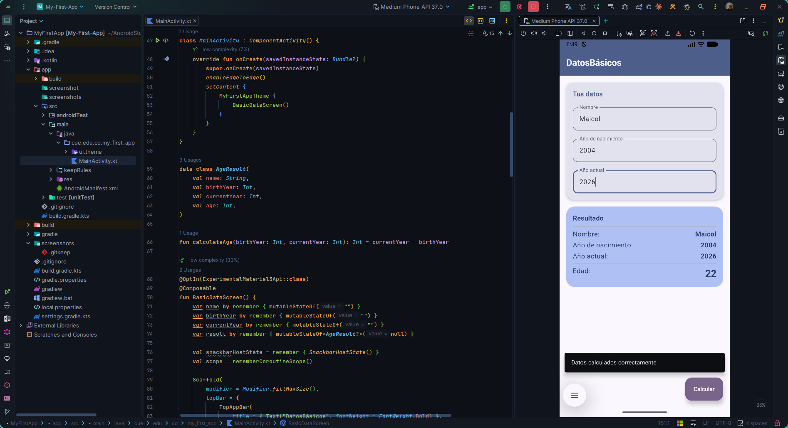

# MyFirstApp

Aplicación Android con Jetpack Compose "Datos Básicos y Edad".

Permite ingresar un nombre, el año de nacimiento y el año actual. Al presionar el botón flotante calcula la edad (`añoActual - añoNacimiento`), muestra los datos en pantalla y un Snackbar con el mensaje "Datos calculados correctamente".

## Capturas

Las imágenes de la aplicación en funcionamiento se encuentran en la carpeta [`screenshots/`](screenshots/).

